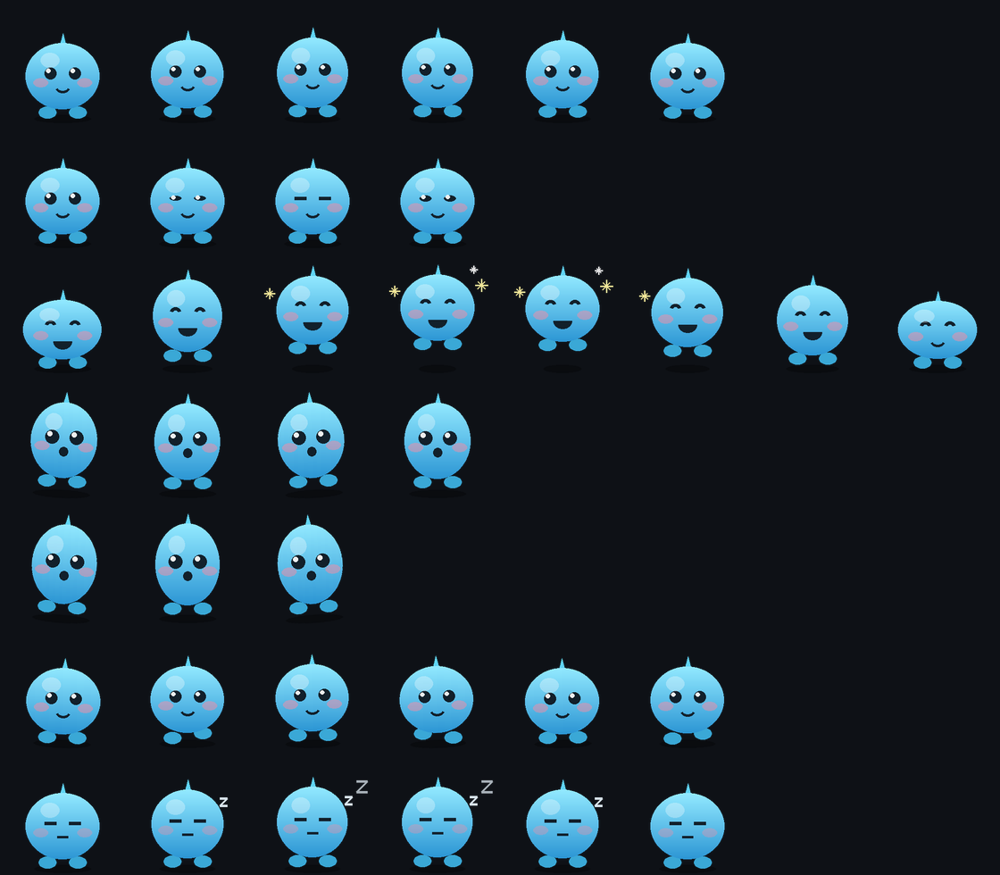

# 桌宠 DeskPet

一个安卓桌宠 App：打开后宠物会**浮在桌面和其他任何 App 之上**，可以拖、可以扔、点一下有反应、长按出菜单。

- 包名：`com.dsh.deskpet`
- 最低版本：Android 8.0（API 26）
- 目标版本：**Android 16（API 36）**
- 针对屏幕：**1440 × 3168**
- 依赖：**纯平台实现**，没有 AndroidX / Material，装完体积不到 1 MB



> 上面这张是内置占位角色「团子」的全部动作（7 组、37 帧）。
> 你随时可以换成自己的素材，见下面《换成你自己的素材》。

---

## 一、装到手机上

成品 APK 在：

```
app/build/outputs/apk/release/app-release.apk
```

安装步骤：

1. 把 `app-release.apk` 传到手机（微信/QQ/USB/网盘都行）。
2. 手机上点开这个文件，系统会提示「未知来源应用」，允许安装。
   - 小米/红米：可能会提示「安全警告」，选**继续安装**；
     如果提示要关闭「MIUI 优化」才能装，去 `设置 → 更多设置 → 开发者选项` 里临时关掉。
   - 安装时如果被手机管家拦截，选「仍要安装」。
3. 装好后打开「桌宠」App。
4. App 里按 **① → ② → ③** 的顺序走：
   - **① 先开权限**：点「去开启悬浮窗权限」，在系统列表里找到「桌宠」并打开。
     （这是必须的，没有它宠物根本画不出来。）
   - **② 叫它出来**：点「开启桌宠」。
5. 退回桌面，宠物就在屏幕底部的正中间。

> 通知权限可开可不开。不开的话只是看不到那条常驻通知，桌宠照样能用。
> 但**建议开**：不然系统可能在某些时候悄悄把服务回收掉。

---

## 二、怎么玩

**悬浮在桌面上时只有两个操作：单击、拖动。** 没长按菜单，改不了任何设置
（这是刻意的 —— 所有设置只能进 App 里改）。

| 操作 | 反应 |
|---|---|
| 点一下 | 它会开心地跳一下 |
| 按住拖动 | 拎起来跟着走 |
| 松手 | 按所在区域吸附到角落或侧边（见下表） |
| 拖过屏幕中线 | 它会翻个身，换到另一边 |

### 吸附分区（1440 × 3168 上的实际像素）

判定基准是桌宠的**底边**和**右边**（`db` = 底边离屏幕底部，`dr` = 右边离屏幕右侧）。
左半屏完全镜像对称。

| 区 | 范围 | 松手后 | 素材 |
|---|---|---|---|
| **A** | `db ≤ 356` 且 `dr ≤ 356` | 吸附右下角 | `右下角`，人物正立 |
| **C** | 排除 A，`db ≤ 200` | 垂直吸附到屏幕底部 | `右边框` **原始素材**（不转） |
| **B** | 排除 A，`dr ≤ 200` | 水平吸附到屏幕右侧 | `右边框` **逆时针 90°** |
| **D** | 排除 A/B/C，`db ≤ 444` 或 `dr ≤ 444`（L 形带） | 离哪边近吸哪边，再按 C / B 规则 | 有**模糊** |
| **E** | 其余 | 同 D，但无模糊 | — |

> 一个容易看错的地方：**A 是 356 宽，而 C/B 只有 200 宽**，
> 所以角附近「底边 ≤200」的点其实早就落进 A 了。
> C 和 B 永远不会重叠，因此「重合以底边为准」这条规则实际上不会触发。

位置和吸附状态都会被记住，下次打开还在原地。
开启「开机自动叫它出来」后，重启手机它会自己回来。

---

## 三、屏幕适配（1440 × 3168）

代码里没有任何写死的像素，全部按屏幕比例算：

- **大小**：宠物高度 = 可活动区域高度 × 比例（默认 15%，可在 App 里 6%～40% 调）。
  在 1440×3168 上，默认大约 **463 px 高**。
- **旋转不变形**：素材永远按自身正立比例等比缩放，旋转由绘制时绕格子中心完成，
  只改朝向、不改比例。
- **底边**：宠物站在「屏幕底部减去导航栏/手势条」的那条线上，
  不会压在手势条下面点不到。
- **位置记忆**：存的是**比例**而不是像素，所以换分辨率、换大小都不会跑出屏幕。
- **动画帧**：素材按原始像素绘制，用 `FILTER_BITMAP_FLAG` 平滑缩放，
  放大到 1440 宽也不会糊。
- **刘海/挖孔**：活动范围从屏幕物理顶端开始算，挖孔在顶部不影响。

---

## 四、换成你自己的素材

内置的「团子」只是占位角色。换成你自己的图只要两步：

### 第 1 步：把素材丢进 `assets-incoming/`

支持 **GIF / 动画 WebP / APNG / PNG 序列**。两种摆法都行：

**方式 A**：一个文件夹 = 一个角色

```
assets-incoming/小猫/
    idle.gif          ← 待机（循环）
    walk.gif          ← 走路
    happy.gif         ← 被点
    drag.gif          ← 被拎起来
    sleep.gif         ← 睡觉
```

**方式 B**：直接一堆文件，用文件名当前缀

```
assets-incoming/
    idle_00.png  idle_01.png  idle_02.png
    walk.gif
    happy.gif
```

文件名决定这是哪段动画，中英文都认：

| 文件名前缀 | 动画 | 说明 |
|---|---|---|
| `idle` / `待机` / `stand` | 待机 | 循环 |
| `blink` / `眨眼` | 眨眼 | 播一次 |
| `happy` / `开心` / `click` | 被点 | 播一次 |
| `drag` / `被拖` / `hold` | 被拎起 | 循环 |
| `fall` / `下落` / `drop` | 下坠 | 循环 |
| `walk` / `走路` / `move` | 溜达 | 循环 |
| `sleep` / `睡觉` / `rest` | 睡着 | 循环 |

**最少你只给一段 `idle` 就能跑**，其余动画会自动回退到 `idle`。

### 第 2 步：跑转换脚本

```powershell
$py = 'C:\Users\13793\.dsh\dsh-runtimes\dsh-primary-runtime\dependencies\python\python.exe'
& $py tools\import_assets.py --name 小猫
```

脚本会：
1. 把 GIF / WebP / APNG 逐帧拆成 PNG；
2. 把所有帧补齐到同一个画布，内容按**底边居中**对齐
   —— 这样不同动画切换时宠物不会上下乱跳；
3. 生成 `pet.json`。

然后重新打包 APK，App 的「角色」下拉框里就会出现它。

### 第三方素材去哪找

- [itch.io](https://itch.io/game-assets/free/tag-animated) — 搜 `pet` / `slime` / `sprite`
- [OpenGameArt](https://opengameart.org/)
- [LPC (Liberated Pixel Cup)](https://lpc.opengameart.org/) — 大量 CC-BY-SA 角色

> 注意版权：用别人的素材时看清许可证，很多要求署名。
> 商业用途务必确认授权。

---

## 五、自己重新打包

工具链已经装在这台机器上了：

| 东西 | 位置 |
|---|---|
| JDK 21 (Temurin) | `D:\dsh\toolchain\jdk\jdk-21.0.12.1+1` |
| Android SDK | `D:\dsh\toolchain\sdk` |
| Gradle 8.13 | `D:\dsh\toolchain\gradle\gradle-8.13` |

在 `pet-app` 目录下，**什么都不用配**，直接：

```powershell
.\gradlew.bat assembleDebug     # 调试包
.\gradlew.bat assembleRelease   # 正式包（已签名，可直接装机）
```

`gradlew.bat` 会自己找到 JDK：优先用环境变量 `JAVA_HOME`，
没有就读项目根目录的 `.jdk-home`（内容就是 JDK 路径，一行）。
所以哪怕在没设过环境变量的终端里也能直接跑。
第一次运行会自动下载 Gradle 8.13（走腾讯镜像，约 137 MB），之后走本地缓存。

也可以绕开 wrapper，直接用机器上装好的 Gradle：

```powershell
& 'D:\dsh\toolchain\gradle\gradle-8.13\bin\gradle.bat' assembleRelease
```

产物：`app/build/outputs/apk/release/app-release.apk`

### 环境变量（已配好，换终端也生效）

已经写进当前用户的用户级环境变量，新开的终端 / Android Studio 都能直接用：

| 变量 | 值 |
|---|---|
| `JAVA_HOME` | `D:\dsh\toolchain\jdk\jdk-21.0.12.1+1` |
| `ANDROID_HOME` | `D:\dsh\toolchain\sdk` |
| `ANDROID_SDK_ROOT` | `D:\dsh\toolchain\sdk` |
| `PATH` | 追加了 `%JAVA_HOME%\bin`、`sdk\platform-tools`、`sdk\cmdline-tools\latest\bin` |

所以 `java`、`adb`、`sdkmanager` 在任何新终端里都能直接敲。
（已经开着的终端要重启才会生效。）

### 模拟器

想先在电脑上看效果，不用真机：

```powershell
& 'D:\dsh\toolchain\sdk\emulator\emulator.exe' -avd pet36
```

AVD `pet36` 就是照你这台手机配的：**1440 × 3168、560 dpi、Android 16 (API 36)**，
和真机比例完全一致，所以布局在模拟器里对了，真机就对了。

装机：

```powershell
adb install -r app\build\outputs\apk\release\app-release.apk
```

> 想在模拟器里直接看到效果，不用点那两步授权：
> ```powershell
> adb shell appops set com.dsh.deskpet SYSTEM_ALERT_WINDOW allow
> adb shell pm grant com.dsh.deskpet android.permission.POST_NOTIFICATIONS
> ```
> 然后打开 App 点「开启桌宠」，按 Home 回桌面就能看到团子浮在下面。

### 环境自检记录

这套环境在 1440 × 3168 / Android 16 的模拟器上**实测跑通过**：

| 检查项 | 结果 |
|---|---|
| `gradlew.bat clean assembleDebug assembleRelease` | BUILD SUCCESSFUL（不设任何环境变量） |
| 产物 ABI / SDK | `targetSdk=36`、`minSdk=26`、`compileSdk=36` |
| 正式包签名 | `apksigner verify` 通过，CN=DeskPet |
| 对齐 | `zipalign -c 4` 通过 |
| 装机 + 启动 | 真机式安装成功，`MainActivity` 正常前台，无崩溃 |
| 悬浮窗 | `PetService` 前台服务启动，overlay 窗口 `appop=SYSTEM_ALERT_WINDOW` 生效 |
| 桌面效果 | 团子正常浮在桌面上（见 `docs/emulator-pet-overlay.png`） |


**签名信息**（升级时要一致，丢了就没法覆盖安装）：

| 项 | 值 |
|---|---|
| keystore | `keystore/deskpet.jks` |
| store password | `deskpet2026` |
| key alias | `deskpet` |
| key password | `deskpet2026` |

> 这个密码是明文写在 `app/build.gradle.kts` 里的，方便你自己重打包。
> 如果你要发布到应用商店，**换成自己的 keystore，并且不要把密码提交到公开仓库**。

---

## 六、项目结构

```
pet-app/
├── app/src/main/
│   ├── AndroidManifest.xml          权限、服务、接收器
│   ├── java/com/dsh/deskpet/
│   │   ├── MainActivity.kt          控制台界面
│   │   ├── PetService.kt            前台服务 + 悬浮窗 + 长按菜单
│   │   ├── PetView.kt               桌宠本体：动画、拖动、物理
│   │   ├── PetSkin.kt               素材加载（读 pet.json）
│   │   ├── Prefs.kt                 偏好存储
│   │   └── BootReceiver.kt          开机自启
│   ├── res/                         界面资源、图标
│   └── assets/pet/default/          内置占位角色（37 帧）
├── tools/
│   ├── make_placeholder_pet.py      生成占位角色
│   ├── import_assets.py             把你自己的素材转成皮肤
│   └── preview_sheet.py             把所有帧拼成预览图
├── assets-incoming/                 ← 你的素材放这里
├── keystore/deskpet.jks             签名密钥
└── docs/preview.png                 动作预览图
```

---

## 七、安卓 16 适配要点

| 项目 | 处理方式 |
|---|---|
| `SYSTEM_ALERT_WINDOW` + `TYPE_APPLICATION_OVERLAY` | 悬浮窗主路径 |
| 前台服务类型（Android 14+ 强制） | `specialUse`，并声明 `FOREGROUND_SERVICE_SPECIAL_USE` 权限和 `PROPERTY_SPECIAL_USE_FGS_SUBTYPE` 说明 |
| Android 13+ 通知权限 | 运行时申请 `POST_NOTIFICATIONS`，拒绝也能用 |
| 强制边到边（targetSdk 35+） | `setDecorFitsSystemWindows(false)` + 手动吃 `systemBars` / `displayCutout` insets |
| 16 KB 页大小 | 无 native 库，天然兼容 |
| 导航栏/手势条 | 活动下边界 = 屏幕高度 − navigationBars inset |
| 屏幕开关 | 监听 `ACTION_SCREEN_ON/OFF`，息屏时停掉动画循环省电 |
| 开机自启限制 | 用 `try/catch` 包住，失败就静默放弃，用户手动开 |

**省电设计**：动画不是死循环刷 60 帧。
物理运动/拖动时用 16 ms 一帧；静止时按当前动画的 fps 走（待机只有 8 fps），
息屏直接停表。

---

## 八、已知限制

- **部分国产系统**（MIUI / EMUI / ColorOS）会额外限制后台和自启。
  如果宠物过一会儿消失，去
  `设置 → 应用管理 → 桌宠 → 省电策略` 改成「无限制」，
  并在最近任务里给这个 App **加锁**。
- 悬浮窗在**锁屏界面**和**部分安全输入界面**（银行 App、支付密码键盘）上会被系统挡住，
  这是安卓的安全机制，任何 App 都绕不过去。
- 长按菜单用的是普通悬浮窗，所以它**不会**跟着系统深色/浅色模式变，
  是固定的深色面板。
